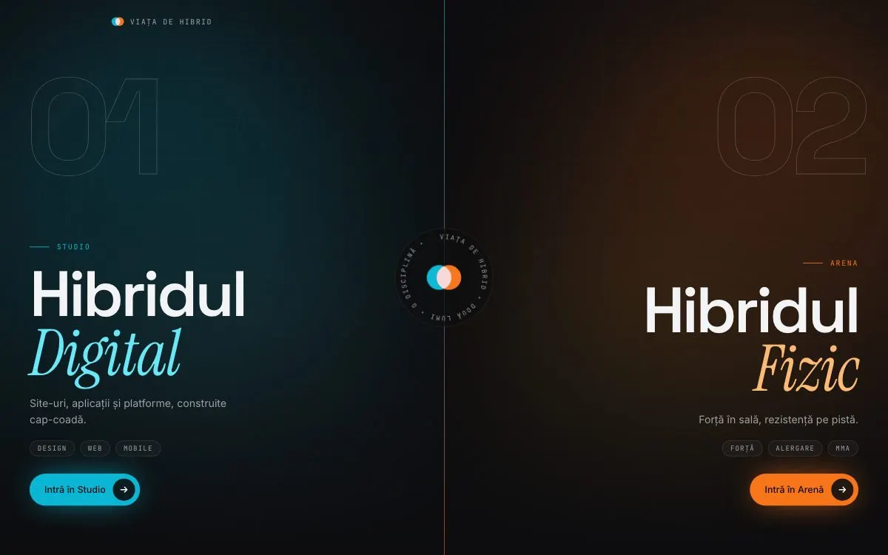

# Viața de Hibrid

Site personal cu două fețe: **Studio**, pentru proiecte digitale, și **Arena**, pentru sport. Motto: *„Două lumi, aceeași disciplină.”*



## Ce conține

- **Pagină de intrare împărțită în două.** Alegi între Studio și Arena, iar fiecare jumătate are culorile și animațiile ei.
- **Studio:** servicii, proiecte prezentate pe un telefon animat, procesul de lucru și formular de contact.
- **Arena:** cele trei discipline (sală, pistă, ring), statistici animate și galerie orizontală.
- **Animații la scroll:** text care apare pe măsură ce derulezi, efecte de lumină care urmăresc cursorul, scroll fin.
- **Zonă de administrare protejată cu PIN:** mesajele primite prin formular, proiectele (adăugare și ștergere) și un grafic cu venituri pe luni.
- **SEO:** imagini de previzualizare generate pentru fiecare pagină, sitemap și robots.

## Tehnologii

Next.js (App Router, Server Actions) · React · TypeScript · Tailwind CSS · Framer Motion · Lenis

## Rulare locală

```bash
npm install
npm run dev
```

Site-ul pornește la http://localhost:3737.

### Zona de administrare

Funcționează doar dacă setezi cele două variabile din `.env.example` într-un fișier `.env.local`:

```bash
DASHBOARD_PIN=pinul-tau
DASHBOARD_SECRET=un-sir-lung-aleator   # de exemplu: openssl rand -hex 32
```

Fără ele, accesul la administrare rămâne blocat. Mesajele și proiectele se salvează local, în folderul `data/`, care nu e urcat pe GitHub.

## Autor

Ioan Manolache · [manolacheioan.github.io](https://manolacheioan.github.io)
